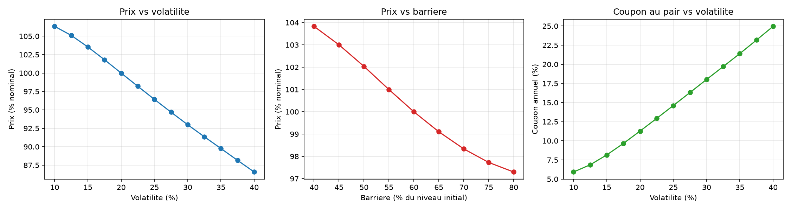

# Pricer d'autocall Athena (Monte Carlo)

Valorisation d'un produit structuré de type Athena sur un sous-jacent unique, en Python (numpy, scipy, matplotlib).

## Le produit

- Nominal 100, maturité 5 ans, observations annuelles.
- **Rappel anticipé** : si le sous-jacent est au-dessus de 100 % de son niveau initial à une date d'observation, le produit est remboursé à 100 % + coupon × nombre d'années écoulées.
- **À maturité**, s'il n'a jamais été rappelé : capital remboursé à 100 % si le sous-jacent est au-dessus de la barrière (60 %), sinon l'investisseur subit la baisse du sous-jacent.

## Méthode

1. Formules fermées de Black-Scholes (prix, delta, vega) comme référence.
2. Moteur Monte Carlo : mouvement brownien géométrique simulé de façon exacte aux dates d'observation, 200 000 trajectoires, variables antithétiques.
3. Validation du moteur : le prix Monte Carlo d'un call européen est comparé à Black-Scholes.
4. Valorisation de l'Athena, recherche du coupon au pair, sensibilités à la volatilité et à la barrière.

## Résultats

Paramètres : taux 3 %, dividende 2 %, volatilité 20 %.

| Validation (call ATM 1 an) | Prix |
|---|---|
| Black-Scholes | 8,2663 |
| Monte Carlo | 8,2899 ± 0,0583 (IC 95 %) |

| Athena 5 ans | |
|---|---|
| Coupon au pair | 11,27 % par an |
| Probabilité de rappel en année 1 | 48,0 % |
| Probabilité de rappel en années 2 / 3 / 4 / 5 | 12,1 % / 6,0 % / 3,7 % / 2,6 % |
| Probabilité de perte en capital | 11,4 % |
| Vega (pour +1 point de vol) | −0,71 |



Le prix baisse quand la volatilité monte : l'investisseur est vendeur d'un put à barrière, dont la valeur augmente avec la volatilité. C'est ce put vendu qui finance le coupon, d'où un coupon au pair croissant avec la volatilité.

## Limites

- Volatilité constante : pas de skew, alors que le put à barrière y est très sensible. Un modèle à volatilité locale ou stochastique donnerait un coupon plus faible.
- Taux et dividendes constants, pas de marge de la banque ni de coût de financement : le coupon obtenu est un majorant de ce qui serait proposé en pratique.
- Barrière observée uniquement à maturité.

## Lancer le code

```bash
pip install numpy scipy matplotlib
python autocall_pricer.py
```
